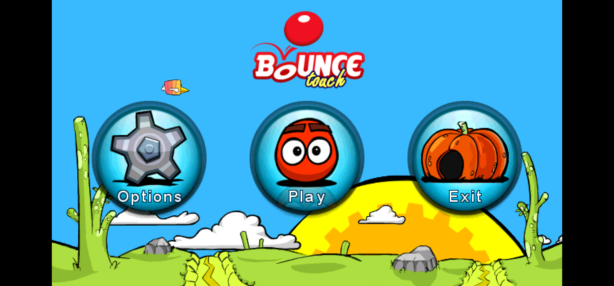
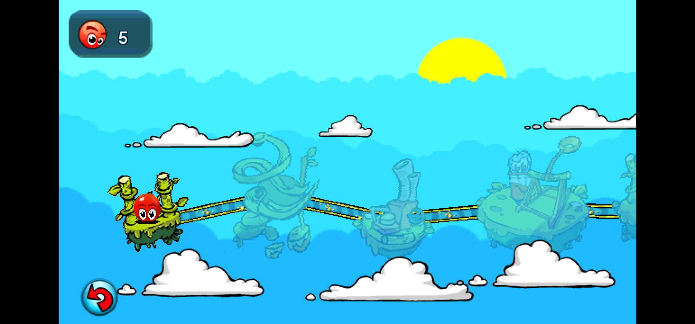
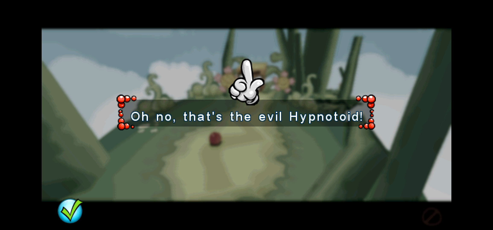
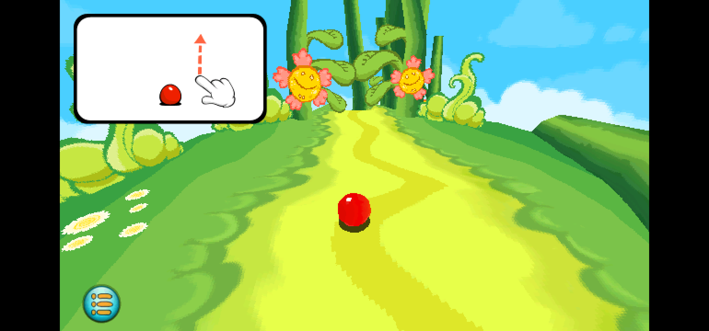
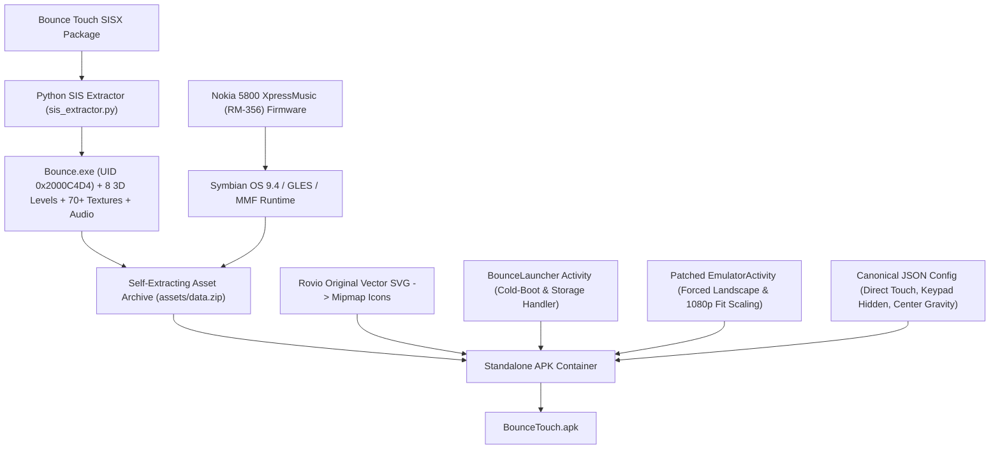

# Bounce Touch 3D - Standalone Android Port

[](https://android.com)
[](#compatibility)
[-red.svg)](#about-the-game)
[](LICENSE)

A standalone native Android port of the legendary Symbian S60v5 3D game **Bounce Touch** (originally developed by **Rovio Mobile** for Nokia touchscreen smartphones in 2008).

Unlike typical emulator setups that require manually downloading ROMs, configuring controls, and navigating emulator menus, this project packages the entire game, Nokia 5800 XpressMusic runtime environment, and assets into a **single, standalone 1-tap Android APK**.

---

## Screenshots

| Main Menu | Overworld Level Select |
| :---: | :---: |
|  |  |

| 3D Cutscene | In-Game 3D Gameplay |
| :---: | :---: |
|  |  |

---

## Key Features

- **Direct 1-Tap Launch**: Tap the app icon and boot straight into Bounce Touch (Rovio splash &rarr; Nokia splash &rarr; Title screen). No emulator UI, file pickers, or prompts.
- **Widescreen 1080p Presentation**: Correctly scales to full screen height (`1920 x 1080` active viewport, centered on ultra-wide screens) while strictly preserving the original 16:9 aspect ratio. Zero stretching or squishing.
- **Pure Touchscreen Controls**: All buttons ("Play", "Options", "Exit", level select, dialogue checkmarks) and in-game gestures (swiping up/down/left/right to roll and bounce the ball) work natively through the touchscreen.
- **Zero On-Screen Keypad Clutter**: All emulator keypad overlays, d-pads, and virtual buttons are completely disabled for an authentic, clean modern game experience.
- **Hardware-Accelerated 3D & High-Fidelity Audio**: Runs on hardware OpenGL ES with Symbian MMF PCM audio delivering full 3D graphics, particle effects, and original music/sfx.
- **Universal Compatibility**: Supports **Android 5.0 (Lollipop) through Android 15+** on all ARM64 and ARM32 devices. Handles modern Scoped Storage gracefully with zero permission hurdles.

---

## About the Game

*Bounce Touch* was released in 2008 by Rovio Mobile as one of the showcase titles for the Nokia 5800 XpressMusic, Nokia's first mass-market Symbian S60 5th Edition touchscreen smartphone. It was acclaimed for its fluid 3D physics, colorful art style, and intuitive touch rolling mechanics.

---

## Architecture & How It Works



### Technical Highlights
1. **Reverse Engineering**:
   - The original Symbian SIS package was parsed using a custom Python extractor (`tools/sis_extractor.py`), extracting the game binaries, 8 full 3D level maps (`.hgr`), particle scripts (`.prs`), textures (`.ntx`), audio tracks, and the original vector SVG icon.
2. **Forced Landscape & Viewport Scaling**:
   - Patched native rendering parameters via Smali bytecode to ensure `scale_type_ = 1` (Fit 16:9) and `gravity_ = 2` (Center), locking the orientation to landscape even if the host device has auto-rotate disabled.
3. **Dedicated Launcher (`BounceLauncher.java`)**:
   - Manages automatic self-extraction of assets into app storage on first run.
   - Launches `EmulatorActivity` directly into Bounce Touch with `appUid=536921300L` (`0x2000C4D4`) and `appDeviceCode="RM-356"`.

---

## Installation

1. Download the latest `BounceTouch.apk` from the **[Releases](../../releases)** tab.
2. Transfer or download the APK onto your Android device.
3. Tap the APK to install it (enable *"Install from Unknown Sources"* if prompted).
4. Tap the **Bounce Touch** icon to play!

---

## Building from Source

### Prerequisites
- JDK 17 (`javac`, `jar`)
- Android SDK Build-Tools (v34.0.0+) with `d8`, `zipalign`, and `apksigner`
- Python 3 with Pillow (for asset extraction tools)
- [Apktool](https://apktool.org/) (`apktool.jar` in `tools/`)

### Build Steps
```bash
# 1. Clone repository
git clone https://github.com/keenglomerate/bounce-touch-android.git
cd bounce-touch-android

# 2. Compile launcher and build APK
./build.sh
```

---

## Compatibility

| Architecture | Status | Notes |
| :--- | :---: | :--- |
| **ARM64 (`arm64-v8a`)** | &check; Supported | Native 64-bit ARM (Samsung, Pixel, Xiaomi, OnePlus, etc.) |
| **ARM32 (`armeabi-v7a`)** | &check; Supported | 32-bit legacy ARM devices |
| **x86 / x86_64** | &check; Supported* | Works on PC emulators with ARM translation (BlueStacks, LDPlayer) |

- **Minimum OS**: Android 5.0 (API 21)
- **Target OS**: Android 14 / 15 (API 34)

---

## License & Disclaimer

- The launcher and porting scripts in this repository are licensed under the **GNU General Public License v3 (GPLv3)**.
- *Bounce Touch* &copy; 2008 Rovio Mobile Ltd. All trademarks and game assets belong to their respective copyright holders.
- This project is an educational and digital preservation effort dedicated to preserving historical Symbian 3D mobile games on modern open platforms.
